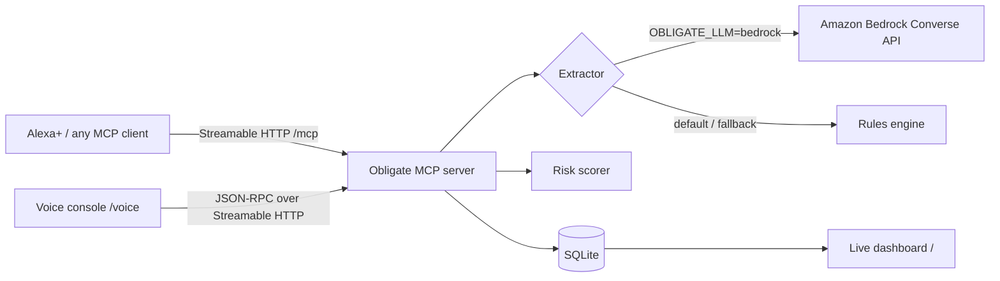

# Obligate

**Say it in a meeting, Obligate tracks it.**

Obligate is an MCP server for Alexa+ that listens for the promises people make in meetings ("I'll send the contract by Friday", "we need to renew the SOC 2 report") and turns them into tracked obligations with an owner, a deadline and a risk level. It catches the commitments nobody owns, the ones that were asked but never confirmed, and the ones that touch contracts, audits, privacy, security or money, before they turn into costly mistakes.

Built for the **Alexa+ track** of *Build, Ship, Shape: Amazon Developer Hackathon 2026*.

- **MCP server**, Streamable HTTP transport, MCP spec **2025-11-25** (also negotiates newer versions)
- **7 voice-first tools**, each returning a `speech` line written to be read aloud, plus structured data
- **Live dashboard** for screens (Echo Show, laptop, team TV)
- **Voice console** (`/voice`) that simulates the Alexa+ experience in the browser over real MCP calls
- **Amazon Bedrock** (Converse API) extraction for messy transcripts, with an offline rules engine as fallback

---

## Why

Most meeting tools give you a transcript or a summary. Neither one tells you that the invoice nobody volunteered to pay is now a day late, or that "I'll try to update the incident policy, maybe" isn't really a commitment. The cost of a dropped promise isn't the task itself. It's the missed renewal, the failed audit, the breached SLA.

Obligate treats every spoken commitment as an **obligation** and scores its risk:

| Signal | Example | Why it matters |
|---|---|---|
| Nobody owns it | "Someone needs to pay the Q3 invoice" | Classic diffusion of responsibility |
| Asked, never confirmed | "Sam, can you send the deck?" (no reply) | The asker thinks it's handled; Sam doesn't |
| Soft commitment | "I'll *try* to update the policy, *maybe*" | Hedged promises slip first |
| Compliance-sensitive | contracts, audits, GDPR/HIPAA, security, invoices, renewals | Slipping these costs money or trust |
| Overdue / due within 48h | "it's already late" | Needs action today |

## Talk to it

> **You:** Alexa, wrap up the meeting.
> **Alexa:** I captured 8 commitments from the vendor review. 3 are high risk. Most urgent: Raj needs to send the renewal contract to legal, due tomorrow. That one is compliance-sensitive (contract, legal, renewal). 2 have no owner. Want me to assign them?
>
> **You:** Give the SOC 2 report to Priya by November 14.
> **Alexa:** Done. Priya needs to renew the SOC 2 report before the customer audit, due November 14. Risk dropped from high to medium.
>
> **You:** What could go wrong?
> **Alexa:** 2 high-risk items. First, nobody owns: pay the Q3 invoice to Acme, 1 day overdue…

## Architecture



| Path | What it is |
|---|---|
| `POST/GET /mcp` | MCP endpoint (Streamable HTTP) |
| `/` | Live dashboard, refreshes every 3 s |
| `/voice` | Alexa+ simulation: speak or type, it calls the MCP tools and speaks the answer |
| `/health` | Health check |
| `/api/obligations` | JSON of all obligations |

## MCP tools

| Tool | Voice example | What it does |
|---|---|---|
| `capture_meeting` | "Wrap up the meeting" | Extracts every commitment from a transcript, dedupes, scores risk |
| `add_obligation` | "Remind me I promised Dana the NDA by Monday" | Tracks one commitment |
| `list_obligations` | "What does Raj owe?" / "What has no owner?" | Filter by owner, due window, risk |
| `risk_report` | "What could go wrong?" | Ranks the most dangerous obligations and says why |
| `briefing` | "Give me my briefing" | Overdue, due today, coming up |
| `complete_obligation` | "Raj sent the renewal contract" | Fuzzy-matches what you said, marks it done |
| `assign_obligation` | "Give the SOC 2 report to Priya by Nov 14" | Fixes unowned / undated risks |

Read-only tools carry `readOnlyHint` annotations; write tools are marked non-destructive. Resource: `obligate://obligations/open`.

## Quick start

```bash
git clone <this repo> && cd obligate
python3 -m venv .venv && source .venv/bin/activate
pip install -r requirements.txt

OBLIGATE_DEMO=1 python3 -m obligate.server
```

- Dashboard: http://localhost:8000/
- Voice console: http://localhost:8000/voice (use Chrome for voice input). Click **Play sample meeting**, then **Wrap up the meeting**.
- MCP endpoint: http://localhost:8000/mcp

Run the tests (with the server running for the end-to-end test):

```bash
python -m pytest -q tests/test_extract.py   # extraction, dates, risk scoring
python tests/test_e2e.py                    # real MCP client over Streamable HTTP, calls every tool
```

### Inspect with MCP Inspector

```bash
npx @modelcontextprotocol/inspector
# Transport: Streamable HTTP, URL: http://localhost:8000/mcp
```

### Make it reachable by Alexa+ (public HTTPS)

Alexa+ needs a public HTTPS URL. The quickest way for a demo is a tunnel:

```bash
cloudflared tunnel --url http://localhost:8000      # or: ngrok http 8000
# then restart the server allowing that hostname (DNS-rebinding protection is on by default):
OBLIGATE_ALLOWED_HOSTS=your-subdomain.trycloudflare.com python -m obligate.server
```

Register `https://<your-host>/mcp` as the server URL in the Alexa+ developer tooling.

For something that stays up, the included `Dockerfile` runs on **AWS App Runner** or ECS Fargate:

```bash
docker build -t obligate . && docker run -p 8000:8000 -e OBLIGATE_ALLOWED_HOSTS=<your-domain> obligate
```

## Amazon Bedrock extraction

The rules engine handles clear speech well ("I'll…", "X, can you…", "X will…", "we need to…"). For real-world transcripts with crosstalk, turn on Bedrock:

```bash
export OBLIGATE_LLM=bedrock
export AWS_REGION=us-east-1
export OBLIGATE_BEDROCK_MODEL=us.amazon.nova-lite-v1:0   # any Converse-compatible model
python -m obligate.server
```

Obligate calls the Bedrock **Converse API** with a structured-extraction prompt, resolves relative dates against the meeting date, and then runs the same risk scorer. If Bedrock errors or isn't configured, it falls back to the rules engine, so a meeting is never lost. See `obligate/extract.py`.

## Configuration

| Variable | Default | Purpose |
|---|---|---|
| `OBLIGATE_HOST` | `127.0.0.1` | Bind address (`0.0.0.0` in Docker) |
| `PORT` | `8000` | Port |
| `OBLIGATE_DB` | `./obligate.db` | SQLite file |
| `OBLIGATE_ALLOWED_HOSTS` | | Comma-separated public hostnames allowed through DNS-rebinding protection |
| `OBLIGATE_LLM` | `rules` | Set to `bedrock` to use Amazon Bedrock |
| `OBLIGATE_BEDROCK_MODEL` | `us.amazon.nova-lite-v1:0` | Bedrock model or inference profile |
| `OBLIGATE_TODAY` | today | Pin "today" for reproducible demos |
| `OBLIGATE_DEMO` | | `1` enables `POST /api/reset` |

## Project layout

```
obligate/
  server.py      MCP server: tools, resource, routes, Streamable HTTP app
  extract.py     commitment extraction (rules + Amazon Bedrock)
  dates.py       "by Friday", "next week", "end of month" → dates
  risk.py        risk scoring + compliance tagging
  store.py       SQLite persistence
  dashboard.py   live dashboard
  static/voice.html  Alexa+ voice simulation
examples/        sample meeting transcript
tests/           unit tests + end-to-end MCP client test
```

## What's next

- Speaker diarization straight from Alexa+ meeting audio
- Proactive Alexa+ notifications the morning an obligation is due
- Calendar, Jira and Slack sync so obligations land where teams already work
- DynamoDB + per-team auth for multi-tenant deployment

## License

MIT. See [LICENSE](LICENSE).
